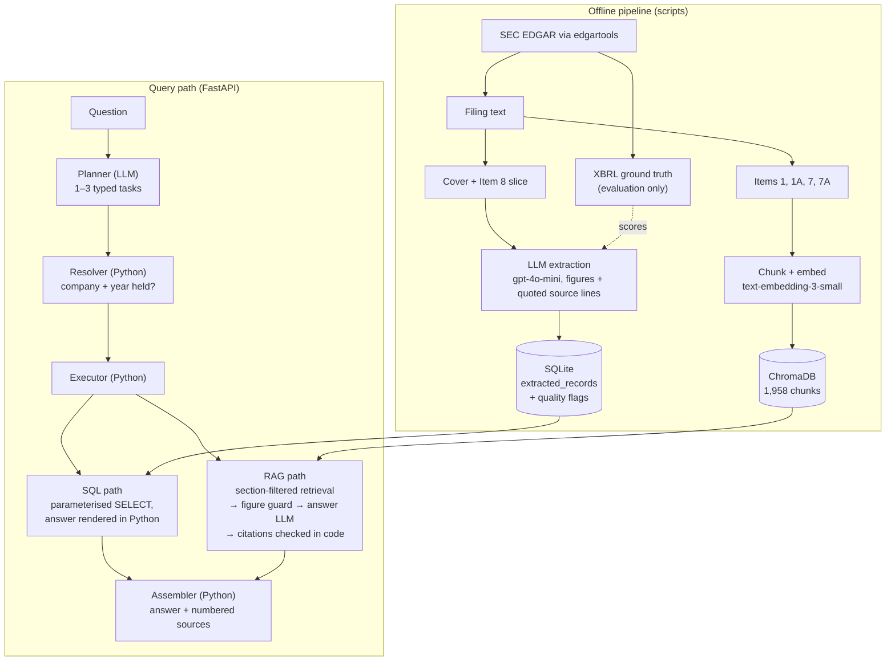

# Enterprise Document Intelligence System

An AI pipeline that turns SEC 10-K filings into structured, queryable and
evaluated data. It extracts financial figures from filing text with an LLM,
indexes the narrative sections for retrieval, and answers questions through a
planner that sends each part of a question either to an exact SQL lookup or to
cited retrieval-augmented generation (RAG). Every stage is measured against
ground truth or frozen labels.

Status: runs locally as a FastAPI service over a 20-filing corpus. Docker
packaging and a hosted demo are not built yet.

---

## The problem

Annual reports hold the numbers and explanations that analysts, auditors and
data teams need, but as long, unstructured documents. A 10-K is tens of
thousands of tokens of text (Apple's FY2021 filing is 47k, Pfizer's FY2023 is
136k). The figures sit in tables flattened into text, under scale headers
("in millions") that may be pages away. Getting them into a structured store
usually means manual work, and a language model asked directly will often
return a figure that looks right and is wrong — the wrong year, the wrong line,
or off by 1,000x.

This project builds the extraction-and-enrichment layer that sits before a
structured data pipeline, and treats measurement as part of the product:

- **Extract** five financial fields per filing with an LLM, each with the
  source line it was read from, and check every citation in code.
- **Answer questions** with exact figures from SQL and cited explanations from
  the filing text, refusing with a specific reason when the corpus cannot answer.
- **Keep stored figures away from any LLM** in the question-answering path, so
  a model cannot restate a figure wrongly.
- **Evaluate each stage separately** — extraction, routing, execution,
  retrieval and attribution — so a wrong answer can be traced to its cause.

## Results

All numbers come from committed result files; methods and caveats are in
[docs/query_eval_results.md](docs/query_eval_results.md) and
[docs/prompt_strategy_results.md](docs/prompt_strategy_results.md).

| Stage | Result | Evidence |
|---|---|---|
| Extraction | Five prompt strategies scored against XBRL ground truth; the winner scores 1.00 on the ten filings it was chosen on and **0.90 on the ten held-out filings** | [results.json](data/eval/results.json), [held_out_results.json](data/eval/held_out_results.json) |
| Routing (planner) | **82.5%** of held-out questions planned correctly before any prompt tuning (clean out-of-sample), 88.9% after | [v1](data/eval/routing_results_0ed3e740.md), [final](data/eval/routing_results_d4bc8e36.md) |
| Execution given the right plan | **100%** (adjudicated; 91.7% raw on held-out, the gap being three label errors) — remaining end-to-end errors are routing | [oracle run](data/eval/execution_results_d4bc8e36_b1d8ee5c_oracle.md) |
| Retrieval | A relevant chunk in the top 5 for every question; capped recall@5 79% held-out, 59% dev | [retrieval_results.md](data/eval/retrieval_results.md) |
| Attribution | **93.2%** of 322 answer sentences supported by their cited text, scored by an LLM judge that caught 30 of 30 planted errors (Cohen's kappa 0.97) | [attribution_results.md](data/eval/attribution_results.md) |

The judge's reference labels were written by a second model (Claude), with every
disagreement adjudicated by the developer — not by human labellers.

---

## Architecture

Two parts: an offline pipeline that builds the corpus, and an online query path
served by the API.



Key properties:

- **No LLM receives a stored figure.** SQL answers are rendered in Python, and
  stored figures in retrieved text are masked before the answer model sees it,
  then redacted if one still appears. This is enforced by structure, not by a
  prompt instruction.
- **XBRL is the answer key only.** It scores the extraction and never reaches
  the database, the answers or the export.
- **Refusals are typed.** "Year not held", "company not in the corpus",
  "section not captured", "figure requested from text" — each with a sentence
  written in Python.
- **Every served figure carries a data-quality flag** (verified, unverified or
  disputed), computed from stored evidence only, and shown in answers, API
  responses and the CSV export.

Why each of these choices was made, and what it costs:
[docs/design_notes.md](docs/design_notes.md).

## Tech stack

| Area | Choice |
|---|---|
| Language | Python 3.11 |
| API | FastAPI + uvicorn |
| LLM orchestration | LangChain 1.x (`with_structured_output`, LCEL) |
| Models | OpenAI gpt-4o-mini (extraction, planner, answers); text-embedding-3-small; gpt-6-luna as the evaluation judge only |
| Acquisition | edgartools (filing text and XBRL) |
| Vector store | ChromaDB (local, persistent, cosine) |
| Metadata store | SQLite + SQLAlchemy 2.x |
| Validation and config | Pydantic v2, pydantic-settings |
| Logging | structlog |
| Tests | pytest |

Exact versions are pinned in `requirements.txt`.

## Repository layout

```
src/
  ingestion/   acquisition, section slicing, chunking
  extraction/  extraction prompts, schemas, pipeline
  storage/     SQLite models, Chroma wrapper, data-quality flag
  query/       planner, resolver, executor, SQL path, answer assembly
  rag/         retriever, figure guard, answer chain
  eval/        ground truth, scorers, evaluation harnesses, attribution judge
  api/         FastAPI app, routes, response models, usage limits, demo page
  utils/       settings, logging, number and name helpers
scripts/       pipeline and evaluation entry points
  diagnostic/  probes and smoke tests used during development
tests/         unit tests (no network, no API key, no database)
docs/          design notes, API contract, evaluation write-ups
data/eval/     committed evaluation evidence: answer key, eval sets, labels, results
```

`data/raw/`, `data/processed/` and `db/` are gitignored: a fresh clone has the
code and the evaluation evidence, but not the built corpus.

---

## Setup

Requires Python 3.11 and an OpenAI API key. Building the corpus also needs
network access to SEC EDGAR.

```bash
git clone https://github.com/vsc-58/enterprise-doc-intelligence.git
cd enterprise-doc-intelligence
python -m venv .venv
source .venv/bin/activate          # Windows Git Bash: source .venv/Scripts/activate
pip install -r requirements.txt
cp .env.example .env               # then set OPENAI_API_KEY and EDGAR_IDENTITY
```

`EDGAR_IDENTITY` is the name and email SEC asks automated clients to send
(for example `Jane Doe jane@example.com`). Every other setting has a default in
`src/utils/config.py` and can be overridden in `.env`.

## Build the corpus

Run from the repository root, in this order. Acquisition, extraction and
embedding skip work already done; the two slicing steps rebuild their files.

```bash
python -m scripts.acquire_filings            # 20 10-K filings + XBRL answer key (SEC)
python -m scripts.build_sections             # cover + Item 8 slices for extraction
python -m scripts.run_extraction --dry-run   # what would be extracted, no spend
python -m scripts.run_extraction             # LLM extraction into SQLite
python -m scripts.build_narrative_sections   # Items 1, 1A, 7, 7A (SEC)
python -m scripts.embed_documents --dry-run  # chunk count and cost, no spend
python -m scripts.embed_documents            # embed into ChromaDB
```

Measured cost of a full build: about $0.16 for extraction and $0.02 for
embeddings. `python -m scripts.acquire_filings 2` acquires only the first two
filings, for a quick check.

## Run the API

```bash
uvicorn src.api.main:app --reload            # http://localhost:8000
```

- `http://localhost:8000/` — a demo page: ask a question, see the answer with
  each figure's quality mark and numbered sources.
- `http://localhost:8000/docs` — Swagger UI with example requests.
- Run **one worker**: the Chroma store is single-process and the usage counters
  are in memory.
- Without a built corpus the server still starts; `/health` returns 503 naming
  the missing part.

| Endpoint | What it does |
|---|---|
| `POST /query` | `{"question": "..."}` → answer text, plan type, per-task status and refusal reason, each figure with its quality flag, numbered sources, planner and chain versions |
| `GET /documents` | The 20 filings held, with ticker, name and fiscal year |
| `GET /export` | `extracted_records` as CSV: each figure beside its quality flag, reason, note and cited line |
| `GET /health` | Readiness of the database, vector store, corpus index and figure guard; 503 names the part that is down |

Status codes: a refusal is a correct answer about the corpus, so it is a 200
with a typed `refusal_reason`. 422 is malformed input, 429 a usage limit (off by
default), 503 not ready or OpenAI unavailable, 504 a timeout after 30 s. The
full contract is [docs/api_contract.md](docs/api_contract.md).

Example (`POST /query`):

```json
{"question": "What was Apple's total revenue in fiscal 2021?"}
```

returns, among other fields:

```json
{
  "answer": "Apple Inc.'s total revenue for fiscal year 2021 (period ending 2021-09-25) was $365.82 billion.",
  "plan_type": "single",
  "tasks": [{"intent": "financial_metric", "tool": "sql", "status": "success",
             "figures": [{"ticker": "AAPL", "value": 365817000000.0,
                          "quality": {"verdict": "verified", "reason": "consistent", "note": null}}]}]
}
```

Asking for a year the corpus does not hold returns a 200 refusal: "I hold one
Apple Inc. filing, for fiscal year 2021. I don't have 2022."

## Tests

```bash
pytest -q
```

399 tests, all without network, database or a real API key: LLM calls are
stubbed. The settings class still requires `OPENAI_API_KEY` and `EDGAR_IDENTITY`
to be present, so set them (any value works) in `.env` or the environment.
`tests/test_prompt_versions.py` checks that the prompt versions in the code are
the ones the committed evaluation results were measured on.

## Reproduce the evaluation

These call OpenAI and need the built corpus. The committed results in
`data/eval/` are what the numbers above come from.

```bash
python -m scripts.run_eval                   # extraction: five strategies, ten filings
python -m scripts.run_heldout_eval           # extraction: the ten held-out filings
python -m scripts.run_routing_eval           # planner accuracy, 3 runs
python -m scripts.run_execution_eval         # oracle and end-to-end execution, 3 runs
python -m scripts.run_retrieval_eval --routing data/eval/routing_results_d4bc8e36.json
python -m scripts.run_attribution_eval --execution data/eval/execution_results_d4bc8e36_b1d8ee5c.json
```

Extraction responses are cached by a hash of strategy, model, prompt and input
text (`data/eval/raw_outputs/`), so re-scoring the strategies costs nothing.

## What to look at

| File | Why |
|---|---|
| [docs/design_notes.md](docs/design_notes.md) | Every major decision, its reason and its cost |
| [docs/query_eval_results.md](docs/query_eval_results.md) | Query-path evaluation: routing, execution, retrieval, attribution, label audits |
| [docs/prompt_strategy_results.md](docs/prompt_strategy_results.md) | Extraction experiment: five strategies, held-out check, two bugs the harness found in itself |
| [docs/api_contract.md](docs/api_contract.md) | API behaviour, status codes, timeouts, usage limits |
| [data/eval/query_eval_set.json](data/eval/query_eval_set.json) | The 109 frozen evaluation questions with labels |
| [data/eval/ground_truth.json](data/eval/ground_truth.json) | XBRL answer key per filing |
| [src/rag/figure_guard.py](src/rag/figure_guard.py) | How stored figures are kept away from the answer model |
| [src/storage/quality.py](src/storage/quality.py) | The data-quality flag |
| [src/api/static/demo.html](src/api/static/demo.html) | The demo page served at `/` |

---

## Evaluation approach

- **Ground truth from XBRL, not hand labels.** The extraction answer key is read
  from each filing's XBRL by exact concept; missing concepts stay null rather
  than being guessed or derived.
- **Held-out data is report-only.** Prompts were revised on development data
  only; the held-out extraction filings and 42 held-out questions were never
  used to change a prompt. The routing figure before any tuning (82.5%) is
  reported as the clean out-of-sample number.
- **Frozen labels.** The question set and retrieval gold are frozen by SHA-256
  and the harnesses refuse edited files. Label errors found later are reported
  as an adjudicated score beside the raw one, never edited.
- **Repeated runs.** LLM measurements run three times (temperature 0 is not
  deterministic); intervals use n = questions.
- **Stage by stage.** Routing is scored on the planner alone; execution runs
  once with the gold plan and once end to end, so routing errors are separated
  from downstream errors.
- **Validated judge.** The attribution judge had to pass criteria fixed before
  it ran: catch planted errors, agree with reference labels (kappa, not raw
  agreement, because 39 of 40 real claims were supported), and stay stable
  across runs.

## Security and data handling

- **Secrets** come from `.env` (gitignored) and the API key is held as a
  `SecretStr`, so it is not printed in logs or reprs. No key is in the code or
  the history.
- **SQL** is built with SQLAlchemy `select()` from validated parameters: column
  allowlist, bound values, a row cap. The model never writes SQL.
- **Errors** return a fixed message and a request id; exception text, paths and
  SQL go to the logs only.
- **The demo page** inserts server text as text, never as HTML.
- **Usage limits** (per-client rate limit, daily budget) protect the OpenAI
  credit on a public deployment. They are off by default.
  `X-Forwarded-For` is never parsed in code, since any client can send it.
- **Data:** all filings are public SEC documents. No personal data is stored.

## Limitations

- **Small corpus:** 20 companies, one fiscal year each (FY2021–2023), so
  cross-year and trend questions are refused as unsupported.
- **Corpus gaps:** the MD&A (Item 7) of Intel, JPMorgan and Exxon and Tesla's
  Item 7A were not captured, so those questions are refused (market-risk
  questions for JPMorgan and Exxon fall back to Item 1A, and say so).
- **Known extraction errors stay visible, not fixed:** Bank of America's four
  figures and Goldman Sachs' operating cash flow are flagged as disputed in
  every answer and in the export.
- **Routing misses remain:** questions about an unnamed company ("that bank")
  can be planned as a 20-company survey; R&D and dividend questions are
  sometimes refused.
- **Retrieval:** chunks lose their subsection heading, which hurts recall on
  long MD&A sections (diagnosed; the fix needs a re-embed).
- **Small evaluation samples:** 18 retrieval questions and 40 judge test
  claims; intervals are wide.
- **API:** no authentication (a public read-only demo), counters reset on
  restart, and CSV cells are not escaped against spreadsheet formulas (all
  values come from filings and the pipeline, not from users).
