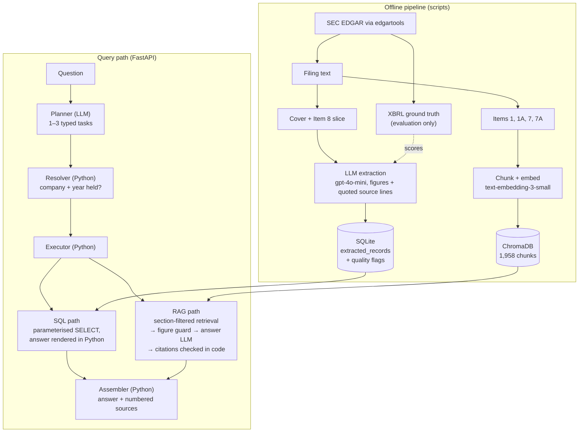

# Enterprise Document Intelligence System

[](https://github.com/vsc-58/enterprise-doc-intelligence/actions/workflows/ci.yml)

An AI pipeline that turns SEC 10-K filings into structured, queryable and
evaluated data. It extracts financial figures from filing text with an LLM,
indexes the narrative sections for retrieval, and answers questions through a
planner that sends each part of a question either to an exact SQL lookup or to
cited retrieval-augmented generation (RAG). Every stage is measured against
ground truth or frozen labels.

Status: live on Google Cloud Run (see Live demo), and runs locally as a
FastAPI service over the same 20-filing corpus, directly or in Docker.

## Live demo

**https://edi-api-808508931004.asia-south1.run.app** — ask a question on the
page, or use the API at `/docs`. No login.

- **First visit after a quiet spell is slow.** The service scales to zero when
  nobody uses it, so the first request starts a fresh instance: the page takes
  about 15–20 seconds (measured 15.0 s and 20.0 s), and the example buttons can
  take as long again. After that, figure questions take about 2 seconds
  (1.4–3.2 s over 14 runs) and narrative answers 7–9 seconds.
- **Usage limits.** Each visitor can ask 10 questions a minute, and all
  visitors together 50 a day (the count restarts at 00:00 UTC, and whenever the
  service restarts). When the demo's OpenAI allowance for the month is used up,
  questions get a short message saying so; the filings list (`/documents`) and
  the extracted figures (`/export`) keep working, because they need no model.
- Same corpus and code as the results below: the hosted service reports the
  planner and answer-chain versions at `/health`.

---

## The problem

Annual reports hold the numbers and explanations that analysts, auditors and
data teams need, but as long, unstructured documents. A 10-K is tens of
thousands of tokens of text (Apple's FY2021 filing is 47k, Pfizer's FY2023 is
136k). The figures sit in tables flattened into text, under scale headers
("in millions") that may be pages away. Getting them into a structured store
usually means manual work, and a language model asked directly will often
return a figure that looks right and is wrong — the wrong year, the wrong line,
or off by 1,000x.

This project builds the extraction-and-enrichment layer that sits before a
structured data pipeline, and treats measurement as part of the product:

- **Extract** five financial fields per filing with an LLM, each with the
  source line it was read from, and check every citation in code.
- **Answer questions** with exact figures from SQL and cited explanations from
  the filing text, refusing with a specific reason when the corpus cannot answer.
- **Keep stored figures away from any LLM** in the question-answering path, so
  a model cannot restate a figure wrongly.
- **Evaluate each stage separately** — extraction, routing, execution,
  retrieval and attribution — so a wrong answer can be traced to its cause.

## Results

All numbers come from committed result files; methods and caveats are in
[docs/query_eval_results.md](docs/query_eval_results.md) and
[docs/prompt_strategy_results.md](docs/prompt_strategy_results.md).

| Stage | Result | Evidence |
|---|---|---|
| Extraction | Five prompt strategies scored against XBRL ground truth; the winner scores 1.00 on the ten filings it was chosen on and **0.90 on the ten held-out filings** | [results.json](data/eval/results.json), [held_out_results.json](data/eval/held_out_results.json) |
| Routing (planner) | **82.5%** of held-out questions planned correctly before any prompt tuning (clean out-of-sample), **87.3%** with the final prompt | [v1](data/eval/routing_results_0ed3e740.md), [final](data/eval/routing_results_0dacd92a.md) |
| Execution given the right plan | **100%** (adjudicated; raw 91.7% held-out and 98.2% dev, the gap being four label errors) — remaining end-to-end errors are routing; end to end 88.1% held-out, 91.0% dev (adjudicated) | [execution run](data/eval/execution_results_0dacd92a_79177d36.md) |
| Retrieval | A relevant chunk in the top 5 for every question; capped recall@5 79% held-out, 59% dev | [retrieval results](data/eval/retrieval_results_0dacd92a.md) |
| Attribution | **91.4%** of 362 answer sentences supported by their cited text, scored by an LLM judge that caught 30 of 30 planted errors (Cohen's kappa 0.97) | [attribution results](data/eval/attribution_results_95183c61_0dacd92a_79177d36.md) |

The query-path numbers were measured on 2026-11-01 with the planner and answer
chain pinned to `gpt-4o-mini-2024-07-18`. The earlier run on the `gpt-4o-mini`
alias (October 2026) is kept beside them, with every difference explained, in
[section 10 of the results](docs/query_eval_results.md#10-re-measurement-on-a-pinned-model).
The 82.5% is from the first prompt version, which exists only in that earlier
run.

The judge's reference labels were written by a second model (Claude), with every
disagreement adjudicated by the developer — not by human labellers.

---

## Architecture

Two parts: an offline pipeline that builds the corpus, and an online query path
served by the API.



Key properties:

- **No LLM receives a stored figure.** SQL answers are rendered in Python, and
  stored figures in retrieved text are masked before the answer model sees it,
  then redacted if one still appears. This is enforced by structure, not by a
  prompt instruction.
- **XBRL is the answer key only.** It scores the extraction and never reaches
  the database, the answers or the export.
- **Refusals are typed.** "Year not held", "company not in the corpus",
  "section not captured", "figure requested from text" — each with a sentence
  written in Python.
- **Every served figure carries a data-quality flag** (verified, unverified or
  disputed), computed from stored evidence only, and shown in answers, API
  responses and the CSV export.

Why each of these choices was made, and what it costs:
[docs/design_notes.md](docs/design_notes.md).

## Tech stack

| Area | Choice |
|---|---|
| Language | Python 3.11 |
| API | FastAPI + uvicorn |
| LLM orchestration | LangChain 1.x (`with_structured_output`, LCEL) |
| Models | OpenAI `gpt-4o-mini-2024-07-18` for the planner and answers, pinned to a dated snapshot; `gpt-4o-mini` for extraction (the name its results were measured and cached under); text-embedding-3-small; gpt-6-luna as the evaluation judge only |
| Acquisition | edgartools (filing text and XBRL) |
| Vector store | ChromaDB (local, persistent, cosine) |
| Metadata store | SQLite + SQLAlchemy 2.x |
| Validation and config | Pydantic v2, pydantic-settings |
| Logging | structlog |
| Tests | pytest |
| Containers | Docker + Docker Compose (one service, one worker) |
| Hosting | Google Cloud Run (one instance, scales to zero), Artifact Registry, Secret Manager |
| CI | GitHub Actions: ruff and pytest on every push and pull request |

Exact versions are pinned in `requirements.txt`.

## Repository layout

```
src/
  ingestion/   acquisition, section slicing, chunking
  extraction/  extraction prompts, schemas, pipeline
  storage/     SQLite models, Chroma wrapper, data-quality flag
  query/       planner, resolver, executor, SQL path, answer assembly
  rag/         retriever, figure guard, answer chain
  eval/        ground truth, scorers, evaluation harnesses, attribution judge
  api/         FastAPI app, routes, response models, usage limits, demo page
  utils/       settings, logging, number and name helpers
scripts/       pipeline and evaluation entry points
  diagnostic/  probes and smoke tests used during development
tests/         unit tests (no network, no API key, no database)
docs/          design notes, API contract, evaluation write-ups
data/eval/     committed evaluation evidence: answer key, eval sets, labels, results
Dockerfile, docker-compose.yml, .dockerignore   the API image and its local run
Dockerfile.cloudrun, Dockerfile.cloudrun.dockerignore   the hosted image (local image + corpus)
scripts/deploy_cloud_run.sh   build, check, push and deploy to Cloud Run
.github/workflows/ci.yml      lint and tests on every push
```

`data/raw/`, `data/processed/` and `db/` are gitignored: a fresh clone has the
code and the evaluation evidence, but not the built corpus.

---

## Setup

Requires Python 3.11 and an OpenAI API key. Building the corpus also needs
network access to SEC EDGAR.

```bash
git clone https://github.com/vsc-58/enterprise-doc-intelligence.git
cd enterprise-doc-intelligence
python -m venv .venv
source .venv/bin/activate          # Windows Git Bash: source .venv/Scripts/activate
pip install -r requirements.txt
cp .env.example .env               # then set OPENAI_API_KEY and EDGAR_IDENTITY
```

`EDGAR_IDENTITY` is the name and email SEC asks automated clients to send
(for example `Jane Doe jane@example.com`). Every other setting has a default in
`src/utils/config.py` and can be overridden in `.env`.

The chat model is set by two settings: `QUERY_MODEL` (planner and answers,
default the dated snapshot `gpt-4o-mini-2024-07-18`) and `EXTRACTION_MODEL`
(default `gpt-4o-mini`). They replace the older `OPENAI_MODEL`; a `.env` that
still sets `OPENAI_MODEL` stops at startup with a message saying which to use.

## Build the corpus

Run from the repository root, in this order. Acquisition, extraction and
embedding skip work already done; the two slicing steps rebuild their files.

```bash
python -m scripts.acquire_filings            # 20 10-K filings + XBRL answer key (SEC)
python -m scripts.build_sections             # cover + Item 8 slices for extraction
python -m scripts.run_extraction --dry-run   # what would be extracted, no spend
python -m scripts.run_extraction             # LLM extraction into SQLite
python -m scripts.build_narrative_sections   # Items 1, 1A, 7, 7A (SEC)
python -m scripts.embed_documents --dry-run  # chunk count and cost, no spend
python -m scripts.embed_documents            # embed into ChromaDB
```

Measured cost of a full build: about $0.16 for extraction and $0.02 for
embeddings. `python -m scripts.acquire_filings 2` acquires only the first two
filings, for a quick check.

## Run the API

```bash
uvicorn src.api.main:app --reload            # http://localhost:8000
```

- `http://localhost:8000/` — a demo page: ask a question, see the answer with
  each figure's quality mark and numbered sources.
- `http://localhost:8000/docs` — Swagger UI with example requests.
- Run **one worker**: the Chroma store is single-process and the usage counters
  are in memory.
- Without a built corpus the server still starts; `/health` returns 503 naming
  the missing part.

| Endpoint | What it does |
|---|---|
| `POST /query` | `{"question": "..."}` → answer text, plan type, per-task status and refusal reason, each figure with its quality flag, numbered sources, planner and chain versions |
| `GET /documents` | The 20 filings held, with ticker, name and fiscal year |
| `GET /export` | `extracted_records` as CSV: each figure beside its quality flag, reason, note and cited line |
| `GET /health` | Readiness of the database, vector store, corpus index and figure guard; 503 names the part that is down |

Status codes: a refusal is a correct answer about the corpus, so it is a 200
with a typed `refusal_reason`. 422 is malformed input, 429 a usage limit (off by
default), 503 not ready or OpenAI unavailable, 504 a timeout after 30 s. The
full contract is [docs/api_contract.md](docs/api_contract.md).

Example (`POST /query`):

```json
{"question": "What was Apple's total revenue in fiscal 2021?"}
```

returns, among other fields:

```json
{
  "answer": "Apple Inc.'s total revenue for fiscal year 2021 (period ending 2021-09-25) was $365.82 billion.",
  "plan_type": "single",
  "tasks": [{"intent": "financial_metric", "tool": "sql", "status": "success",
             "figures": [{"ticker": "AAPL", "value": 365817000000.0,
                          "quality": {"verdict": "verified", "reason": "consistent", "note": null}}]}]
}
```

Asking for a year the corpus does not hold returns a 200 refusal: "I hold one
Apple Inc. filing, for fiscal year 2021. I don't have 2022."

## Run with Docker

Needs Docker with Compose, a `.env` file (as in Setup) and the built corpus in
`db/`. The image holds the code and the pinned requirements; the corpus is
mounted from `./db`, not copied into the image.

```bash
docker compose up --build -d          # build the image and start the API
docker compose logs -f app            # "api_started ... ready=True" when the corpus loaded
curl http://localhost:8000/health     # 200 with document and chunk counts
docker compose down                   # stop
```

- Same endpoints as above, on `http://localhost:8000`.
- One uvicorn worker, as in "Run the API", for the same two reasons.
- `./db` is mounted read-write. The API only reads the corpus, but Chroma writes
  to its own files whenever it opens a store, so a read-only mount does not
  work. The container runs as UID 1000, which must be able to write `./db`.
- Back up `db/` before the first run on a new machine: the store is then
  opened, and written, by a different operating system.
- Stop the container before running any pipeline script on the host: the Chroma
  store supports one process at a time.
- Without a corpus the container still starts; `/health` returns 503 naming the
  missing parts, and the container reports itself unhealthy.
- The image is about 1 GB, most of it the dependencies of edgartools and
  chromadb (pyarrow, onnxruntime, kubernetes). The API imports neither
  pipeline; a smaller image would need a second, API-only requirements file.

## How it is deployed

The live demo runs on Google Cloud Run, from the same image as "Run with
Docker" plus the corpus.

- **Image:** `Dockerfile.cloudrun` starts from the local image and adds only
  `db/` and the start command, so the hosted service runs exactly the code that
  runs locally. Its own ignore file lets in the corpus and nothing else (no
  `.env`, no data files). The image lives in a private Artifact Registry
  repository; the corpus never enters git.
- **Secrets:** the OpenAI key and the EDGAR identity are in Secret Manager.
  Cloud Run reads them when an instance starts, as a service account whose only
  permission is reading those two secrets. No key is in the image, the
  repository or the deploy script.
- **One instance, scaled to zero:** at most one instance (the Chroma store is
  single-process and the usage counters are in memory) and none when idle, so
  an idle demo costs nothing and the first visitor waits for a cold start.
- **Startup probe on `/health`:** a new instance gets traffic only after the
  corpus has loaded; an image with a broken corpus fails its deploy and the
  previous version keeps serving.
- **Client address:** uvicorn takes the address Cloud Run's front end appends
  to `X-Forwarded-For`, which a client cannot forge, so the per-visitor limit
  cannot be dodged with a fake header.
- **Cost limits, in layers:** the per-visitor and daily limits in the API; a
  hard monthly spend limit on the OpenAI project that holds the demo's key; a
  Google Cloud spend cap on the service and an alert budget.
- **Logs:** one JSON object per line (`LOG_FORMAT=json`), which Cloud Logging
  reads by severity.

Deploying is one script with every setting explained in it:

```bash
bash scripts/deploy_cloud_run.sh all     # build, check, push, deploy, verify
```

It runs by hand, not as continuous deployment on merge: the corpus is
deliberately not in git, so a pipeline would have nothing to build the image
from. CI (lint and tests) runs on every push.

## Tests

```bash
pytest -q
```

442 tests, all without network, database or a real API key: LLM calls are
stubbed. GitHub Actions runs them, and ruff, on every push and pull request.
The settings class still requires `OPENAI_API_KEY` and `EDGAR_IDENTITY`
to be present, so set them (any value works) in `.env` or the environment.
`tests/test_prompt_versions.py` checks that the prompt versions in the code are
the ones the committed evaluation results were measured on.

## Reproduce the evaluation

These call OpenAI and need the built corpus. The committed results in
`data/eval/` are what the numbers above come from.

```bash
python -m scripts.run_eval                   # extraction: five strategies, ten filings
python -m scripts.run_heldout_eval           # extraction: the ten held-out filings
python -m scripts.run_routing_eval           # planner accuracy, 3 runs
python -m scripts.run_execution_eval         # oracle and end-to-end execution, 3 runs
python -m scripts.run_retrieval_eval --routing data/eval/routing_results_0dacd92a.json
python -m scripts.run_attribution_eval --execution data/eval/execution_results_0dacd92a_79177d36.json
```

`0dacd92a` and `79177d36` are the first eight characters of the planner and
chain versions, shown by `GET /health` and written into every result file name;
a prompt or model change gives new ones. Before
any paid call, the routing, execution and attribution scripts make one tiny
call and refuse to run unless OpenAI serves the configured model under exactly
that name (a dated snapshot, not an alias); the served name is recorded in each
result file. `python -m scripts.diagnostic.probe_served_model` shows the same
check for every configured chat model.

Extraction responses are cached by a hash of strategy, model, prompt and input
text (`data/eval/raw_outputs/`), so re-scoring the strategies costs nothing.

## What to look at

| File | Why |
|---|---|
| [docs/design_notes.md](docs/design_notes.md) | Every major decision, its reason and its cost |
| [docs/query_eval_results.md](docs/query_eval_results.md) | Query-path evaluation: routing, execution, retrieval, attribution, label audits |
| [docs/prompt_strategy_results.md](docs/prompt_strategy_results.md) | Extraction experiment: five strategies, held-out check, two bugs the harness found in itself |
| [docs/api_contract.md](docs/api_contract.md) | API behaviour, status codes, timeouts, usage limits |
| [data/eval/query_eval_set.json](data/eval/query_eval_set.json) | The 109 frozen evaluation questions with labels |
| [data/eval/ground_truth.json](data/eval/ground_truth.json) | XBRL answer key per filing |
| [src/rag/figure_guard.py](src/rag/figure_guard.py) | How stored figures are kept away from the answer model |
| [src/storage/quality.py](src/storage/quality.py) | The data-quality flag |
| [src/api/static/demo.html](src/api/static/demo.html) | The demo page served at `/` |

---

## Evaluation approach

- **Ground truth from XBRL, not hand labels.** The extraction answer key is read
  from each filing's XBRL by exact concept; missing concepts stay null rather
  than being guessed or derived.
- **Held-out data is report-only.** Prompts were revised on development data
  only; the held-out extraction filings and 42 held-out questions were never
  used to change a prompt. The routing figure before any tuning (82.5%) is
  reported as the clean out-of-sample number.
- **Frozen labels.** The question set and retrieval gold are frozen by SHA-256
  and the harnesses refuse edited files. Label errors found later are reported
  as an adjudicated score beside the raw one, never edited.
- **Repeated runs.** LLM measurements run three times (temperature 0 is not
  deterministic); intervals use n = questions.
- **Pinned model.** The query path runs a dated model snapshot, the evaluation
  scripts refuse to run unless OpenAI serves exactly that snapshot, and every
  result file records the model that answered.
- **Stage by stage.** Routing is scored on the planner alone; execution runs
  once with the gold plan and once end to end, so routing errors are separated
  from downstream errors.
- **Validated judge.** The attribution judge had to pass criteria fixed before
  it ran: catch planted errors, agree with reference labels (kappa, not raw
  agreement, because nearly every real claim was supported), and stay stable
  across runs. Validation re-runs every time the score is computed.

## Security and data handling

- **Secrets** come from `.env` (gitignored) locally and from Secret Manager in
  the hosted service. The API key is held as a `SecretStr`, so it is not
  printed in logs or reprs. No key is in the code, the history or the image.
- **Least privilege:** the hosted service runs as a service account with no
  project roles, allowed only to read its two secrets. The demo's OpenAI key
  belongs to its own project, limited to the two models the API calls and to
  a hard monthly spend limit.
- **SQL** is built with SQLAlchemy `select()` from validated parameters: column
  allowlist, bound values, a row cap. The model never writes SQL.
- **Errors** return a fixed message and a request id; exception text, paths and
  SQL go to the logs only.
- **The demo page** inserts server text as text, never as HTML.
- **Usage limits** (per-client rate limit, daily budget) protect the OpenAI
  credit on the public deployment. They are off by default and on in the
  hosted service. `X-Forwarded-For` is never parsed in code, since any client
  can send it.
- **Data:** all filings are public SEC documents. No personal data is stored.

## Limitations

- **Small corpus:** 20 companies, one fiscal year each (FY2021–2023), so
  cross-year and trend questions are refused as unsupported.
- **Corpus gaps:** the MD&A (Item 7) of Intel, JPMorgan and Exxon and Tesla's
  Item 7A were not captured, so those questions are refused (market-risk
  questions for JPMorgan and Exxon fall back to Item 1A, and say so).
- **Known extraction errors stay visible, not fixed:** Bank of America's four
  figures and Goldman Sachs' operating cash flow are flagged as disputed in
  every answer and in the export.
- **Routing misses remain:** questions about an unnamed company ("that bank")
  can be planned as a 20-company survey; R&D and dividend questions are
  sometimes refused; a single survey question is sometimes split into two or
  three surveys, which repeats work.
- **Retrieval:** chunks lose their subsection heading, which hurts recall on
  long MD&A sections (diagnosed; the fix needs a re-embed).
- **Small evaluation samples:** 18 retrieval questions and 40 judge test
  claims; intervals are wide.
- **API:** no authentication (a public read-only demo), and CSV cells are not
  escaped against spreadsheet formulas (all values come from filings and the
  pipeline, not from users).
- **Hosting:** the usage counters live in memory, so they reset whenever the
  instance restarts or scales to zero; someone who pauses long enough gets a
  fresh daily budget, and the OpenAI and Google spend limits are what hold
  then. One instance means requests queue under load. The first request after
  a quiet spell waits 15–20 s for a cold start, and when a page sends several
  requests at that moment Cloud Run can briefly start a second instance
  (observed once; Google documents it), which delays them further and briefly
  splits the usage counters.
- **Logs:** with JSON logs, `gcloud run services logs read` shows the app's
  lines without their content; read them with `gcloud logging read` or the
  Logs Explorer. uvicorn's own startup lines stay plain text.
