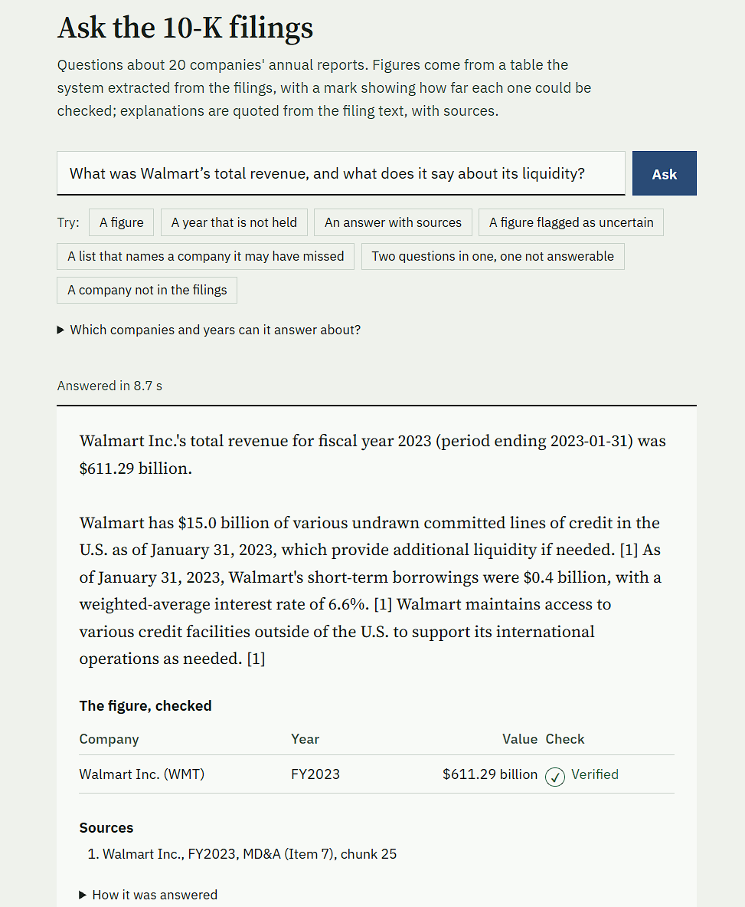
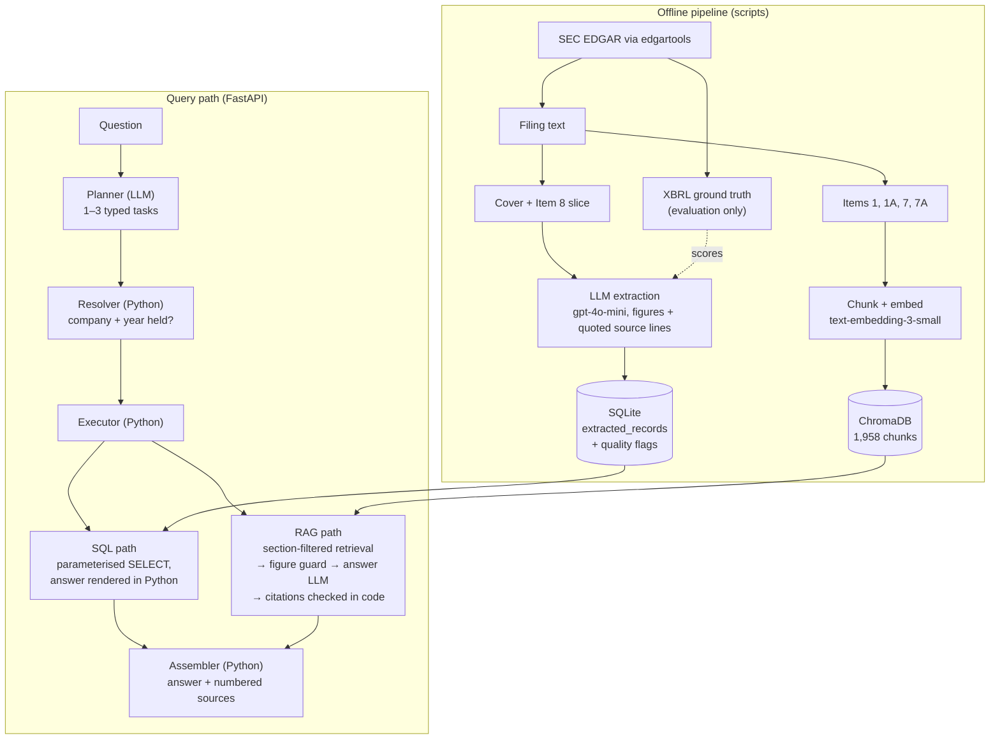

# Enterprise Document Intelligence System

[](https://github.com/vsc-58/enterprise-doc-intelligence/actions/workflows/ci.yml)


[](https://edi-api-808508931004.asia-south1.run.app)
[](LICENSE)

An AI pipeline that turns SEC 10-K filings into structured, queryable and
evaluated data. It extracts financial figures from filing text with an LLM,
indexes the narrative sections for retrieval, and answers questions through a
planner that sends each part of a question either to an exact SQL lookup or to
cited retrieval-augmented generation (RAG). Every stage is measured against
ground truth or frozen labels.

**Live demo: https://edi-api-808508931004.asia-south1.run.app** — ask a
question on the page, or use the API at `/docs`. No login.



## At a glance

- **Exact figures from SQL, explanations from cited text:** one question can
  use both, and no language model ever sees a stored figure.
- **Measured at every stage:** extraction F1 0.90 on held-out filings; routing
  87.3% (82.5% before any tuning); end to end 88.1% on held-out questions;
  91.4% of answer sentences supported by their citations.
- **Deployed and tested:** live on Google Cloud Run with secrets in Secret
  Manager, per-visitor rate limits and spend caps; 442 tests and lint run on
  every push.

## Contents

[The problem](#the-problem) ·
[Results](#results) ·
[Architecture](#architecture) ·
[How it is deployed](#how-it-is-deployed) ·
[Tech stack](#tech-stack) ·
[Run it](#run-it) ·
[Repository layout](#repository-layout) ·
[What to look at](#what-to-look-at) ·
[Evaluation approach](#evaluation-approach) ·
[Security](#security-and-data-handling) ·
[Limitations](#limitations) ·
[License](#license)

## The problem

Annual reports hold the numbers and explanations that analysts, auditors and
data teams need, but as long, unstructured documents. A 10-K is tens of
thousands of tokens of text (Apple's FY2021 filing is 47k, Pfizer's FY2023 is
136k). The figures sit in tables flattened into text, under scale headers
("in millions") that may be pages away. Getting them into a structured store
usually means manual work, and a language model asked directly will often
return a figure that looks right and is wrong — the wrong year, the wrong line,
or off by 1,000x.

This project builds the extraction-and-enrichment layer that sits before a
structured data pipeline, and treats measurement as part of the product:

- **Extract** five financial fields per filing with an LLM, each with the
  source line it was read from, and check every citation in code.
- **Answer questions** with exact figures from SQL and cited explanations from
  the filing text, refusing with a specific reason when the corpus cannot answer.
- **Keep stored figures away from any LLM** in the question-answering path, so
  a model cannot restate a figure wrongly.
- **Evaluate each stage separately** — extraction, routing, execution,
  retrieval and attribution — so a wrong answer can be traced to its cause.

## Results

All numbers come from committed result files; methods and caveats are in
[docs/query_eval_results.md](docs/query_eval_results.md) and
[docs/prompt_strategy_results.md](docs/prompt_strategy_results.md).

| Stage | Result | Evidence |
|---|---|---|
| Extraction | Five prompt strategies scored against XBRL ground truth; the winner scores 1.00 on the ten filings it was chosen on and **0.90 on the ten held-out filings** | [results.json](data/eval/results.json), [held_out_results.json](data/eval/held_out_results.json) |
| Routing (planner) | **82.5%** of held-out questions planned correctly before any prompt tuning (clean out-of-sample), **87.3%** with the final prompt | [v1](data/eval/routing_results_0ed3e740.md), [final](data/eval/routing_results_0dacd92a.md) |
| Execution given the right plan | **100%** (adjudicated; raw 91.7% held-out and 98.2% dev, the gap being four label errors) — remaining end-to-end errors are routing; end to end 88.1% held-out, 91.0% dev (adjudicated) | [execution run](data/eval/execution_results_0dacd92a_79177d36.md) |
| Retrieval | A relevant chunk in the top 5 for every question; capped recall@5 79% held-out, 59% dev | [retrieval results](data/eval/retrieval_results_0dacd92a.md) |
| Attribution | **91.4%** of 362 answer sentences supported by their cited text, scored by an LLM judge that caught 30 of 30 planted errors (Cohen's kappa 0.97) | [attribution results](data/eval/attribution_results_95183c61_0dacd92a_79177d36.md) |

The query-path numbers were measured on 2026-11-01 with the planner and answer
chain pinned to `gpt-4o-mini-2024-07-18`. The earlier run on the `gpt-4o-mini`
alias (October 2026) is kept beside them, with every difference explained, in
[section 10 of the results](docs/query_eval_results.md#10-re-measurement-on-a-pinned-model).
The 82.5% is from the first prompt version, which exists only in that earlier
run.

The judge's reference labels were written by a second model (Claude), with every
disagreement adjudicated by the developer — not by human labellers.

---

## Architecture

Two parts: an offline pipeline that builds the corpus, and an online query path
served by the API.



Key properties:

- **No LLM receives a stored figure.** SQL answers are rendered in Python, and
  stored figures in retrieved text are masked before the answer model sees it,
  then redacted if one still appears. This is enforced by structure, not by a
  prompt instruction.
- **XBRL is the answer key only.** It scores the extraction and never reaches
  the database, the answers or the export.
- **Refusals are typed.** "Year not held", "company not in the corpus",
  "section not captured", "figure requested from text" — each with a sentence
  written in Python.
- **Every served figure carries a data-quality flag** (verified, unverified or
  disputed), computed from stored evidence only, and shown in answers, API
  responses and the CSV export.

Why each of these choices was made, and what it costs:
[docs/design_notes.md](docs/design_notes.md).

## How it is deployed

- **Image:** the same Docker image as local runs, plus the corpus. The corpus
  never enters git; the image is in a private registry.
- **Secrets:** the OpenAI key and the EDGAR identity are in Secret Manager,
  read at start by a service account whose only permission is reading them.
- **One instance, scaled to zero:** an idle demo costs nothing. The first
  visitor after a quiet spell waits about 15–20 s; after that, figure questions
  take about 2 s (1.4–3.2 s over 14 runs) and narrative answers 7–9 s.
- **Usage limits:** 10 questions a minute per visitor, keyed on an address a
  client cannot forge, and 50 a day in total. When the demo's OpenAI allowance
  is used up, questions get a short message saying so; `/documents` and
  `/export` keep working, because they need no model.
- **Cost limits in layers:** a hard spend limit on the OpenAI project that
  holds the demo's key, a Google Cloud spend cap on the service, and an alert
  budget.
- **A broken image never serves:** the startup probe calls `/health`, which is
  200 only once the corpus has loaded, so a bad deploy fails and the previous
  version keeps serving.

Deployment is one script (`scripts/deploy_cloud_run.sh`), run by hand: the
corpus is deliberately not in git, so a pipeline would have nothing to build
the image from. CI runs lint, tests and coverage on every push. Details:
[docs/running.md](docs/running.md#deploy-to-google-cloud-run) and
[design notes, section 9](docs/design_notes.md#9-hosting).

## Tech stack

| Area | Choice |
|---|---|
| Language | Python 3.11 |
| API | FastAPI + uvicorn |
| LLM orchestration | LangChain 1.x (`with_structured_output`, LCEL) |
| Models | OpenAI `gpt-4o-mini-2024-07-18` for the planner and answers, pinned to a dated snapshot; `gpt-4o-mini` for extraction (the name its results were measured and cached under); text-embedding-3-small; gpt-6-luna as the evaluation judge only |
| Acquisition | edgartools (filing text and XBRL) |
| Vector store | ChromaDB (local, persistent, cosine) |
| Metadata store | SQLite + SQLAlchemy 2.x |
| Validation and config | Pydantic v2, pydantic-settings |
| Logging | structlog |
| Tests | pytest: 442 tests, 72% line coverage (API 99.5%, query path 91%) |
| Containers | Docker + Docker Compose (one service, one worker) |
| Hosting | Google Cloud Run (one instance, scales to zero), Artifact Registry, Secret Manager |
| CI | GitHub Actions: ruff and pytest on every push and pull request |

Exact versions are pinned in `requirements.txt`.

## Run it

Requires Python 3.11 and an OpenAI API key. Building the corpus also needs
network access to SEC EDGAR and costs about $0.18.

```bash
git clone https://github.com/vsc-58/enterprise-doc-intelligence.git
cd enterprise-doc-intelligence
python -m venv .venv && source .venv/bin/activate   # Git Bash: .venv/Scripts/activate
pip install -r requirements.txt
cp .env.example .env                                # then set OPENAI_API_KEY and EDGAR_IDENTITY
# build the corpus: seven commands, listed in docs/running.md
uvicorn src.api.main:app                            # or: docker compose up --build
pytest -q                                           # 442 tests, no network or key needed
```

Everything else, including the API's endpoints and status codes, Docker,
deployment and reproducing each evaluation number, is in
[docs/running.md](docs/running.md).

## Repository layout

```
src/
  ingestion/   acquisition, section slicing, chunking
  extraction/  extraction prompts, schemas, pipeline
  storage/     SQLite models, Chroma wrapper, data-quality flag
  query/       planner, resolver, executor, SQL path, answer assembly
  rag/         retriever, figure guard, answer chain
  eval/        ground truth, scorers, evaluation harnesses, attribution judge
  api/         FastAPI app, routes, response models, usage limits, demo page
  utils/       settings, logging, number and name helpers
scripts/       pipeline and evaluation entry points
  diagnostic/  probes and smoke tests used during development
tests/         unit tests (no network, no API key, no database)
docs/          design notes, API contract, evaluation write-ups, how to run
data/eval/     committed evaluation evidence, with an index (data/eval/README.md)
Dockerfile, docker-compose.yml, .dockerignore   the API image and its local run
Dockerfile.cloudrun, Dockerfile.cloudrun.dockerignore   the hosted image (local image + corpus)
scripts/deploy_cloud_run.sh   build, check, push and deploy to Cloud Run
.github/workflows/ci.yml      lint, tests and coverage on every push
pyproject.toml                lint and coverage settings (dependencies: requirements.txt)
LICENSE                       MIT
```

`data/raw/`, `data/processed/` and `db/` are gitignored: a fresh clone has the
code and the evaluation evidence, but not the built corpus.

---

## What to look at

| File | Why |
|---|---|
| [docs/design_notes.md](docs/design_notes.md) | Every major decision, its reason and its cost |
| [docs/query_eval_results.md](docs/query_eval_results.md) | Query-path evaluation: routing, execution, retrieval, attribution, label audits |
| [docs/prompt_strategy_results.md](docs/prompt_strategy_results.md) | Extraction experiment: five strategies, held-out check, two bugs the harness found in itself |
| [docs/api_contract.md](docs/api_contract.md) | API behaviour, status codes, timeouts, usage limits |
| [docs/running.md](docs/running.md) | Setup, corpus build, local and Docker runs, deployment, tests, reproducing the numbers |
| [data/eval/README.md](data/eval/README.md) | Which evidence file is behind which number, and which files are history |
| [data/eval/query_eval_set.json](data/eval/query_eval_set.json) | The 109 frozen evaluation questions with labels |
| [data/eval/ground_truth.json](data/eval/ground_truth.json) | XBRL answer key per filing |
| [src/rag/figure_guard.py](src/rag/figure_guard.py) | How stored figures are kept away from the answer model |
| [src/storage/quality.py](src/storage/quality.py) | The data-quality flag |
| [src/api/static/demo.html](src/api/static/demo.html) | The demo page served at `/` |

---

## Evaluation approach

- **Ground truth from XBRL, not hand labels.** The extraction answer key is read
  from each filing's XBRL by exact concept; missing concepts stay null rather
  than being guessed or derived.
- **Held-out data is report-only.** Prompts were revised on development data
  only; the held-out extraction filings and 42 held-out questions were never
  used to change a prompt. The routing figure before any tuning (82.5%) is
  reported as the clean out-of-sample number.
- **Frozen labels.** The question set and retrieval gold are frozen by SHA-256
  and the harnesses refuse edited files. Label errors found later are reported
  as an adjudicated score beside the raw one, never edited.
- **Repeated runs.** LLM measurements run three times (temperature 0 is not
  deterministic); intervals use n = questions.
- **Pinned model.** The query path runs a dated model snapshot, the evaluation
  scripts refuse to run unless OpenAI serves exactly that snapshot, and every
  result file records the model that answered.
- **Stage by stage.** Routing is scored on the planner alone; execution runs
  once with the gold plan and once end to end, so routing errors are separated
  from downstream errors.
- **Validated judge.** The attribution judge had to pass criteria fixed before
  it ran: catch planted errors, agree with reference labels (kappa, not raw
  agreement, because nearly every real claim was supported), and stay stable
  across runs. Validation re-runs every time the score is computed.

## Security and data handling

- **Secrets** come from `.env` (gitignored) locally and from Secret Manager in
  the hosted service. The API key is held as a `SecretStr`, so it is not
  printed in logs or reprs. No key is in the code, the history or the image.
- **Least privilege:** the hosted service runs as a service account with no
  project roles, allowed only to read its two secrets. The demo's OpenAI key
  belongs to its own project, limited to the two models the API calls and to
  a hard monthly spend limit.
- **SQL** is built with SQLAlchemy `select()` from validated parameters: column
  allowlist, bound values, a row cap. The model never writes SQL.
- **Errors** return a fixed message and a request id; exception text, paths and
  SQL go to the logs only.
- **The demo page** inserts server text as text, never as HTML.
- **Usage limits** (per-client rate limit, daily budget) protect the OpenAI
  credit on the public deployment. They are off by default and on in the
  hosted service. `X-Forwarded-For` is never parsed in code, since any client
  can send it.
- **Data:** all filings are public SEC documents. No personal data is stored.

## Limitations

- **Small corpus:** 20 companies, one fiscal year each (FY2021–2023), so
  cross-year and trend questions are refused as unsupported.
- **Corpus gaps:** the MD&A (Item 7) of Intel, JPMorgan and Exxon and Tesla's
  Item 7A were not captured, so those questions are refused (market-risk
  questions for JPMorgan and Exxon fall back to Item 1A, and say so).
- **Known extraction errors stay visible, not fixed:** Bank of America's four
  figures and Goldman Sachs' operating cash flow are flagged as disputed in
  every answer and in the export.
- **Routing misses remain:** questions about an unnamed company ("that bank")
  can be planned as a 20-company survey; R&D and dividend questions are
  sometimes refused; a single survey question is sometimes split into two or
  three surveys, which repeats work.
- **Retrieval:** chunks lose their subsection heading, which hurts recall on
  long MD&A sections (diagnosed; the fix needs a re-embed).
- **Small evaluation samples:** 18 retrieval questions and 40 judge test
  claims; intervals are wide.
- **API:** no authentication (a public read-only demo), and CSV cells are not
  escaped against spreadsheet formulas (all values come from filings and the
  pipeline, not from users).
- **Hosting:** the usage counters live in memory, so they reset whenever the
  instance restarts or scales to zero; someone who pauses long enough gets a
  fresh daily budget, and the OpenAI and Google spend limits are what hold
  then. One instance means requests queue under load. The first request after
  a quiet spell waits 15–20 s for a cold start, and when a page sends several
  requests at that moment Cloud Run can briefly start a second instance
  (observed once; Google documents it), which delays them further and briefly
  splits the usage counters.
- **Logs:** with JSON logs, `gcloud run services logs read` shows the app's
  lines without their content; read them with `gcloud logging read` or the
  Logs Explorer. uvicorn's own startup lines stay plain text.

## License

MIT: see [LICENSE](LICENSE). The filings themselves are public SEC documents.
